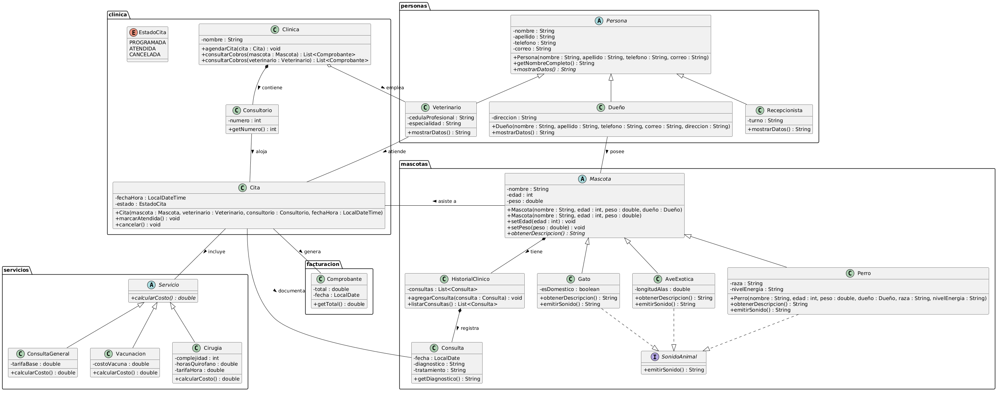
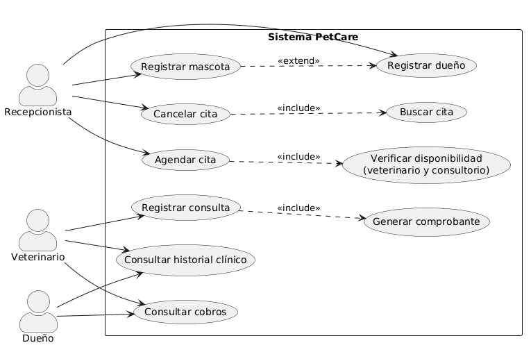

# Examen Parcial Integrador: Clínica Veterinaria PetCare

## Parte 1: Análisis y diseño con UML

### 1.1 Identificación de clases y objetos
| **Clase**            | **Tipo**    | **Atributos principales**                 | **Responsabilidades (métodos)**                                       | **Justificación**                                               |
|----------------------|-------------|-------------------------------------------|-----------------------------------------------------------------------|-----------------------------------------------------------------|
| **Persona**          | Abstracta   | nombre, apellido, telefono, correo        | getNombreCompleto(), mostrarDatos()                                   | Clase padre que contendrá dueños, veterinarios y recepcionistas |
| **Dueño**            | Concreta    | direccion                                 | mostrarDatos()                                                        | Tiene dirección y posee mascotas                                |
| **Veterinario**      | Concreta    | cedulaProfesional, especialidad           | mostrarDatos()                                                        | Atiende citas y existe aunque la clínica cierre.                |
| **Recepcionista**    | Concreta    | turno                                     | mostrarDatos()                                                        | Tiene turno                                                     |
| **Mascota**          | Abstracta   | nombre, edad, peso                        | setEdad(), setPeso() , mostrarDatos()                                 | Clase padre de perro, gato y ave                                |
| **Perro**            | Concreta    | raza, nivelEnergia                        | emitirSonido()                                                        | Tiene raza, nivel de energia y sonido propio                    |
| **Gato**             | Concreta    | esDomestico                               | emitirSonido()                                                        | Puede ser domestico y tiene sonido propio                       |
| **AveExotica**       | Concreta    | longitudAlas                              | emitirSonido()                                                        | Tiene longitud de alas y sonido propio                          |
| **HistorialClinico** | Concreta    | consultas                                 | agregarConsulta(), verConsultas()                                     | Solo tiene sentido dentro de una mascota                        |
| **Consulta**         | Concreta    | fecha, diagnostico, tratamiento           | getDiagnostico()                                                      | Registro clínico dentro del historial                           |
| **Consultorio**      | Concreta    | numero                                    | getNumero()                                                           | Pertenece a la clínica y desaparece con ella                    |
| **Clinica**          | Concreta    | nombre, consultorios, veterinarios, citas | agendarCita(), consultarCobros()                                      | Coordina el sistema y agrupa consultorios y personal            |
| **Cita**             | Concreta    | fechaHora, estado                         | marcarAtendida(), cancelar()                                          | Relaciona mascota, veterinario y consultorio en una fecha       |
| **EstadoCita**       | Enumeración | PROGRAMADA, ATENDIDA, CANCELADA           |                                                                       | Estados de la cita                                              |
| **Servicio**         | Abstracta   |                                           | calcularCosto()                                                       | Cada servicio calcula su costo distinto                         |
| **ConsultaGeneral**  | Concreta    | tarifaBase                                | calcularCosto()                                                       | Costo = tarifa base                                             |
| **Vacunacion**       | Concreta    | costoVacuna                               | calcularCosto()                                                       | Costo = costo de la vacuna                                      |
| **Cirugia**          | Concreta    | complejidad, horasQuirofano, tarifaHora   | calcularCosto()                                                       | Costo depende de complejidad y horas de quirófano               |
| **Comprobante**      | Concreta    | total, fecha                              | getTotal()                                                            | Documento que se genera al terminar una cita                    |
| **SonidoAnimal**     | Interfaz    |                                           | emitirSonido()                                                        | Interfaz de sonido para perro, gato y ave.                      |

### 1.2 Diagrama de clases

### 1.3 Justificación de relaciones
* `Dueño – Mascota` (asociación “posee”): Son independientes. Un dueño puede tener varias mascotas, pero la mascota no es parte del dueño. Si se elimina un dueño, sus mascotas deben reasignarse o darse de baja, pero no se borran automáticamente con él.
* `Clinica – Consultorio` (composición “contiene”): Los consultorios pertenecen a la clínica y desaparecen con ella. Un consultorio no tiene sentido fuera de su clínica.
* `Clinica – Veterinario` (agregación “emplea”): El veterinario es parte del equipo, pero existe aunque la clínica cierre y puede trabajar en otra.
* `Mascota – HistorialClinico` (composición “tiene”): El historial no existe sin la mascota. Si la mascota se elimina, el historial se elimina con ella.
* `HistorialClinico – Consulta` (composición “registra”): Una consulta solo tiene sentido dentro del historial de una mascota.
* `Veterinario – Cita` (asociación “atiende”): Una cita se relaciona con un veterinario, pero el veterinario existe sin ella y la cita sin el veterinario no se agenda.

### 1.4 Diagrama de casos de uso
