# Examen Parcial Integrador: Clínica Veterinaria PetCare

## Parte 1: Análisis y diseño con UML

### 1.1 Identificación de clases y objetos  
[Tabla identificación clases](docs/analisis.md)

### 1.2 Diagrama de clases
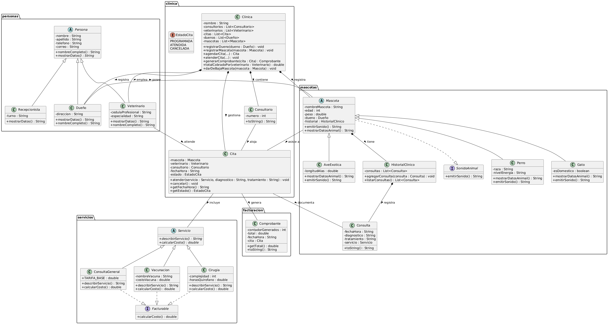

### 1.3 Justificación de relaciones
* `Dueño – Mascota` (asociación “posee”): Son independientes, un dueño puede tener varias mascotas, pero la mascota no es parte del dueño. Si se elimina un dueño, sus mascotas deben reasignarse o darse de baja, pero no se borran automáticamente con él.
* `Clinica – Consultorio` (composición “contiene”): Los consultorios pertenecen a la clínica y desaparecen con ella. Un consultorio no tiene sentido fuera de su clínica.
* `Clinica – Veterinario` (agregación “emplea”): El veterinario es parte del equipo, pero existe aunque la clínica cierre y puede trabajar en otra.
* `Mascota – HistorialClinico` (composición “tiene”): El historial no existe sin la mascota. Si la mascota se elimina, el historial se elimina con ella.
* `HistorialClinico – Consulta` (composición “registra”): Una consulta solo tiene sentido dentro del historial de una mascota.
* `Veterinario – Cita` (asociación “atiende”): Una cita se relaciona con un veterinario, pero el veterinario existe sin ella y la cita sin el veterinario no se agenda.

### 1.4 Diagrama de casos de uso
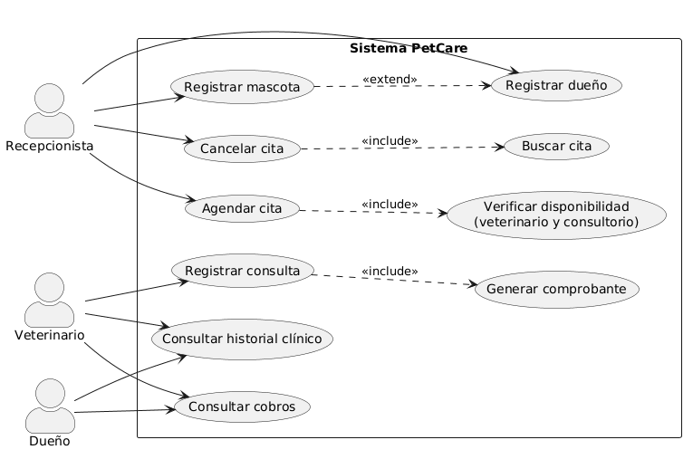

## Parte 2: Implementación en Java
### Códigos:  
* [app](src/app)
  - [Main.java](src/app/Main.java)
  
* [modelo](src/modelo)
    * [personas](src/modelo/personas)
        * [Persona.java](src/modelo/personas/Persona.java)
        * [Dueno.java](src/modelo/personas/Dueno.java)
        * [Veterinario.java](src/modelo/personas/Veterinario.java)
        * [Recepcionista.java](src/modelo/personas/Recepcionista.java)
    * [mascotas](src/modelo/mascotas)
        - [SonidoAnimal.java](src/modelo/mascotas/SonidoAnimal.java)
        - [Mascota.java](src/modelo/mascotas/Mascota.java)
        - [Perro.java](src/modelo/mascotas/Perro.java)
        - [Gato.java](src/modelo/mascotas/Gato.java)
        - [AveExotica.java](src/modelo/mascotas/AveExotica.java)
        - [HistorialClinico.java](src/modelo/mascotas/HistorialClinico.java)
    * [servicios](src/modelo/servicios)
        - [Facturable.java](src/modelo/servicios/Facturable.java)
        - [Servicio.java](src/modelo/servicios/Servicio.java)
        - [ConsultaGeneral.java](src/modelo/servicios/ConsultaGeneral.java)
        - [Cirugia.java](src/modelo/servicios/Cirugia.java)
        - [Vacunacion.java](src/modelo/servicios/Vacunacion.java)
    * [clinica](src/modelo/clinica)
        - [EstadoCita.java](src/modelo/clinica/EstadoCita.java)
        - [Clinica.java](src/modelo/clinica/Clinica.java)
        - [Consultorio.java](src/modelo/clinica/Consultorio.java)
        - [Cita.java](src/modelo/clinica/Cita.java)
        - [Consulta.java](src/modelo/clinica/Consulta.java)
        - [Comprobante.java](src/modelo/clinica/Comprobante.java)

## Parte 3: Escenario de demostración
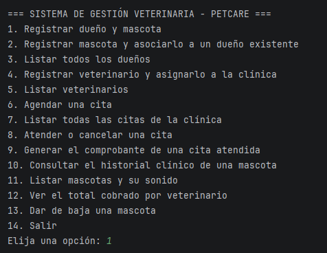
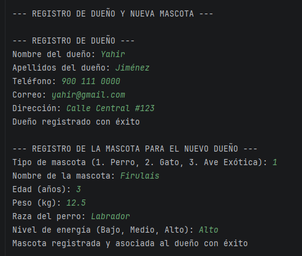
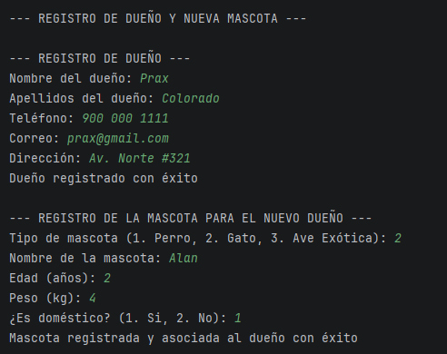
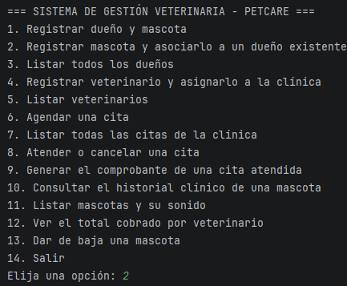
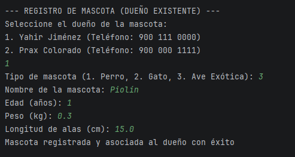
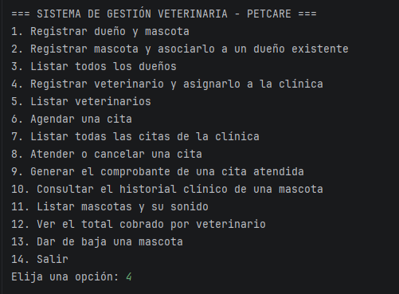
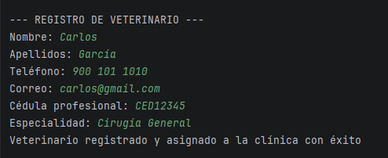
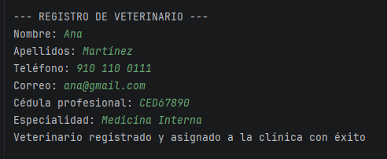
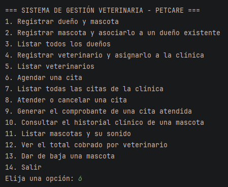
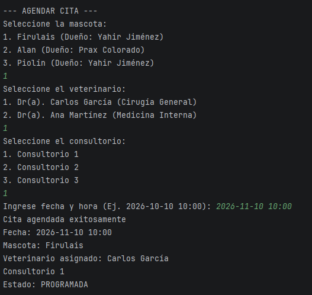
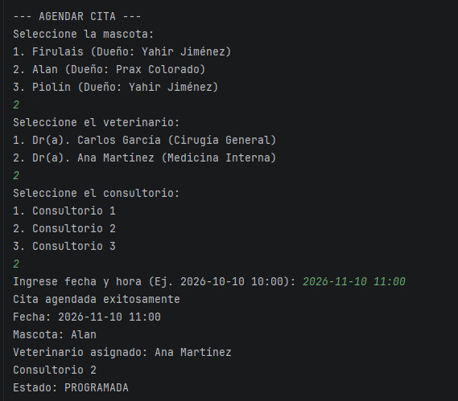
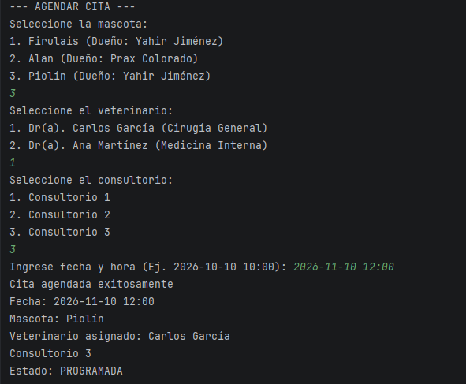
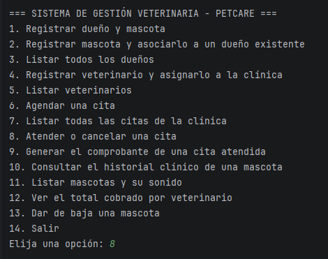

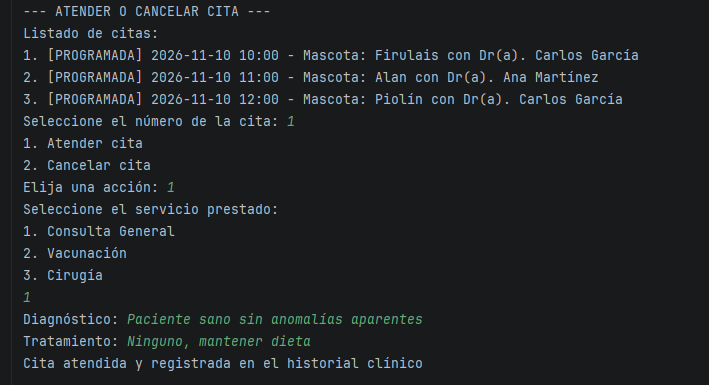
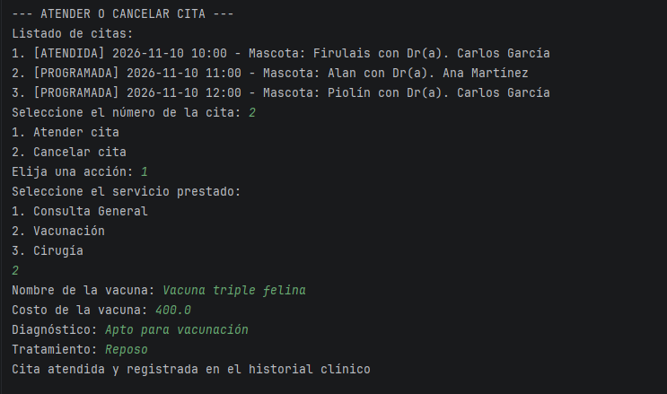
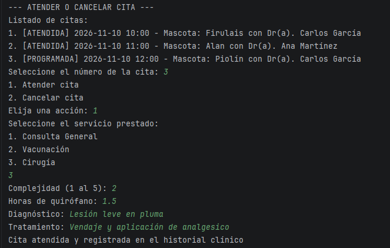
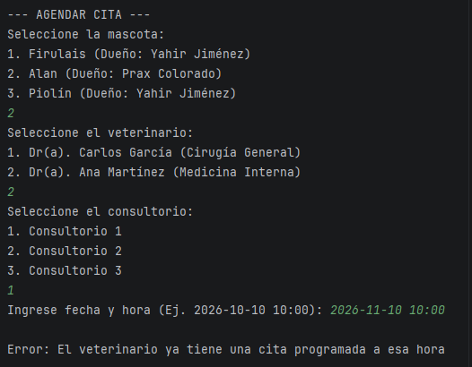

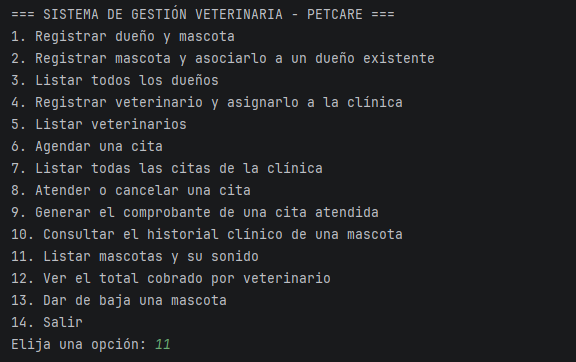
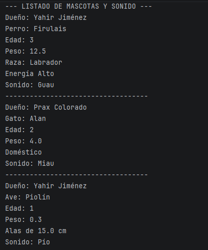

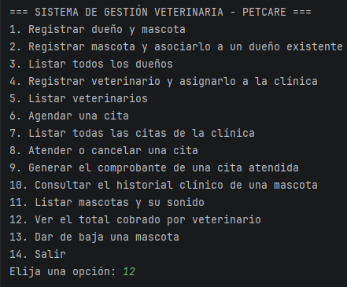
